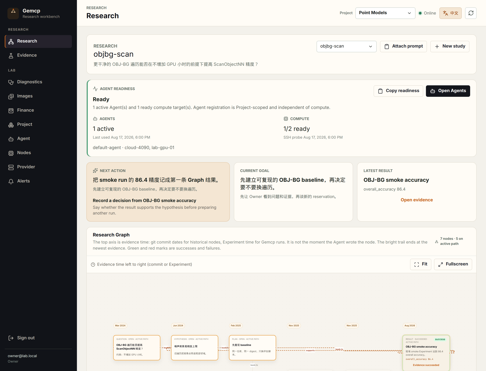
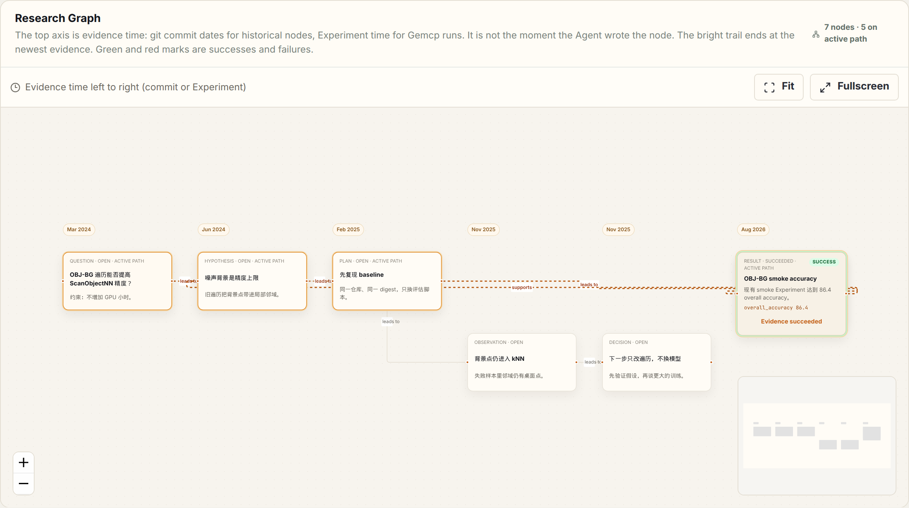

<div align="center">

# Gemcp

**Let your coding agent run experiments. You keep the budget, the secrets, and an honest lab notebook.**

A private research workbench. Coding agents propose the next experiment over MCP. You confirm the exact spend. Gemcp schedules the run on a laptop CPU, an SSH host, your own GPUs, or AutoDL, and writes the result back as evidence.

[](https://github.com/XR-Lee/Gemcp/actions/workflows/ci.yml)
[](docs/releases.md)
[](#roadmap)
[](go.mod)
[](LICENSE)
[](docs/mcp.md)
[](#benchmark)
[](#contributing)

**English** · [中文](README.zh.md)

[Quick start](#quick-start-laptop-no-gpu) · [Benchmark](#benchmark) · [How a run starts](#how-a-paid-run-starts) · [Docs](#documentation) · [FAQ](#faq) · [Contributing](#contributing)

</div>

> **Work in progress (WIP).** Gemcp is an early alpha. APIs, the UI, and the docs may change. Feedback now shapes what it becomes, so [tell us what you think](#contributing).

> **This README is for people.**
> Coding agents working in this repository: [AGENTS.md](AGENTS.md).
> Agents connected to a running Gemcp over MCP: [guides/agent-mcp.md](guides/agent-mcp.md) (or call `get_usage_guide`).

<p align="center">
  
</p>
<p align="center"><em>Research is the home view. Lab (budget, Provider, nodes, alerts) stays one click away.</em></p>

## Why Gemcp?

Coding agents are good at proposing the next experiment. Letting one actually launch it raises three problems:

| | The problem | What Gemcp does |
| --- | --- | --- |
| 💸 **Spend** | An agent holding a cloud token can start a GPU job you never approved. | The agent prepares a zero-cost proposal and must show you its digest — repo, commit, command, resource, and worst-case cost — before it submits. ([Server-side enforcement is still open.](#what-the-benchmark-still-finds)) |
| 🧾 **Evidence** | The agent's summary drifts from what actually ran. | `close_run` copies the metric from the Experiment itself. Runs and results are system-written, and the agent cannot rewrite them afterwards. |
| 🔐 **Secrets** | Provider tokens and SSH keys end up in the agent's context. | They stay in a separate **Lab** layer, with audit. Agents never receive them. |

## What you get

- 🔬 **Owner-first console** — start from the research question, not from GPU inventory.
- ✅ **Human-confirmed spend** — an agent prepares; you approve the exact digest before budget is reserved.
- 🔌 **MCP in the research repo** — Cursor, Claude Code, Codex, OpenCode, Grok, and Pi. Enable Gemcp in that directory, not as a global server.
- 🖥️ **Four compute backends** — local CPU (no NVIDIA), Cloud SSH, Self-hosted Docker GPUs, or AutoDL. They do not silently fall back to one another.
- 🧭 **One vocabulary** — Study, hypothesis, run, result. The same words appear in the console, MCP, and the [Graph contract](docs/graph-contract.md).
- 📏 **A benchmark for the record itself** — CI checks that the Graph says what actually happened. See [Benchmark](#benchmark).

## Quick start (laptop, no GPU)

You need a Go 1.21+ command (the `go.mod` pin is 1.26.10 and will download that toolchain), Node.js 22+, and PostgreSQL 16+ on `127.0.0.1:5432`. Debian/Ubuntu apt Go and PostgreSQL are enough to bootstrap.

```bash
./scripts/bootstrap-local.sh
./scripts/dev-serve.sh
```

Open [http://127.0.0.1:8080](http://127.0.0.1:8080). The first visit is setup (Owner → Compute → Project). Skip AutoDL. Copy the Agent Token once — Gemcp will not show it again. Owner email/password come from `.env` (`GEMCP_DEV_OWNER_*`).

That script writes repo-root `.env` from `deploy/env.local.example`, generates `GEMCP_MASTER_KEY` and `GEMCP_BOOTSTRAP_TOKEN`, creates the `gemcp` role/database, and builds `./bin/gemcp`. Do **not** copy `.env.example` for this path (that file is the production Compose template).

In a second terminal, optional checks:

```bash
./scripts/local-http-smoke.sh   # health, setup, MCP initialize
./scripts/local-cpu-loop.sh     # five-step CPU experiment, no NVIDIA
```

The console language toggle is on the top bar (Chinese / English). Stuck anywhere? That is a bug in this page — please [open an issue](https://github.com/XR-Lee/Gemcp/issues/new?title=%5Bquick%20start%5D%20).

## Benchmark

How do you know the Graph tells the truth? We measure it.

[`internal/researchbench`](docs/research-bench.md) runs four small research tasks with known answers through the real MCP server, on SQLite. Each task hides one trap: a lucky seed, a misleading outside claim, a sweet spot a coarse grid misses, or a batch size that runs out of memory. Three scripted agents work the tasks. The scorer then reads the record back through MCP, without trusting the agent's own account. It runs on every pull request (`go test ./...`) and fails if any record metric regresses.

**What an Owner reads, before and after the evidence fixes** (same agents, same 4 tasks, 49 runs):

| Record metric | Before¹ | `main` today² |
| --- | ---: | ---: |
| Run verdicts recorded correctly | 15/49 (31%) | **49/49 (100%)** |
| False `supports` on the Graph | 29 | **0** |
| Crashed runs recorded as evidence | 5/5 | **0/5** |
| Runs with conflicting verdicts | 12 | **0** |
| Numbers labelled measured vs asserted | 0/100 | **100/100** |
| Plan-sync report checks passed | 24/134 (18%) | **134/134 (100%)** |
| Misleading next step after a crash | 5/5 | **0/5** |
| Evidence rewrites that changed the record | 4/5 | **0/5** |
| Tool calls per run | 7.7 | **5.6** (−27%) |
| Tool output per run | 57.1 KB | **35.9 KB** (−37%) |

<sub>¹ `main` at `79cdb72`, just before the fixes in `df0a3bb` and `6bd24cf`. ² `b546e47`. Both columns were re-run for this page with the same harness. Full table, including each rewrite attempt: [docs/research-bench.md](docs/research-bench.md#results).</sub>

**The benchmark tells good research from bad.** The scripted agents are reference policies, not language models:

| Agent | Strategy | Correct conclusions | Search tasks solved | Mean normalized score S |
| --- | --- | ---: | ---: | ---: |
| `careful` | Coarse grid, then refine near the best point; three seeds per effect | 4/4 | 2/2 | 1.00 |
| `grid` | Evenly spaced grid over the whole budget | 4/4 | 1/2 | 0.74 |
| `hasty` | One run, one seed; reads a crash as a negative result | 1/4 | 0/2 | −0.01 |

Reproduce it in about five seconds, with no GPU and no PostgreSQL:

```bash
go test ./internal/researchbench -run TestResearchBench -v
```

### What the benchmark still finds

These are open, and each one is a good place to start a conversation or a pull request:

- **Owner confirmation is a protocol, not yet server-enforced.** `prepare_experiment` returns the digest to the agent, and `submit_prepared_experiment` accepts it without the Owner. The guides tell agents to wait; an unattended bot can skip that.
- **Tool output grows with the Graph.** Every Graph write returns the whole workspace — about 39 KB per run on a 12-run Study. That is a real context cost for a language-model agent.
- **One hypothesis holds about 42 runs.** The 128-node Study cap counts each run's run, result, and highlight, and the refusal arrives at submit.
- **Execution is simulated.** The scheduler, Provider, Runner, and artifacts are covered by [diagnostics](docs/diagnostics.md) and `./scripts/local-cpu-loop.sh`, not by this benchmark.

### 🏁 Benchmark your agent

The scorer reads only MCP, so it can grade a Study that *any* agent ran on a live Gemcp: Claude Code, Cursor, Codex, OpenCode, Grok, Pi, or your own. We have no real language-model results yet. Run one task, then [post your numbers in an issue](https://github.com/XR-Lee/Gemcp/issues/new?title=%5Bbench%5D%20%3Cagent%3E%20on%20%3Ctask%3E) — failures are as useful as wins. Steps: [Grading a live agent](docs/research-bench.md#grading-a-live-agent).

## How a paid run starts

```text
You record a hypothesis on the Graph
        │
Agent prepares a zero-cost proposal  (prepare_experiment)
        │
You confirm the exact digest
        │
Agent submits once                   (submit_prepared_experiment)
        │
Gemcp writes the run, then the result (close_run)
```

Recording a Graph node never starts a machine. `submit_experiment` is an Advanced compatibility path and is rejected while a Study is active.

<p align="center">
  
</p>
<p align="center"><em>The Graph is a scientific lineage, not a git commit graph. A paid run starts from a connected hypothesis.</em></p>

## Connect an agent

1. Sign in and open **Lab → Agent**.
2. Create a short-lived **MCP setup link** (Handshake prompt if you also want Cloud SSH). Send it only to the intended agent, in the research repository directory.
3. Let the agent enroll itself. Do not paste a long-lived Token into chat.
4. Before any paid run, the agent must show you the proposal (repo, commit, command, resource, worst-case CNY, confirmation digest). Approve that exact digest — in Evidence, or by telling the agent to submit it.

Cursor project config (`.cursor/mcp.json`), after you have a Token in the environment:

```json
{
  "mcpServers": {
    "gemcp-project": {
      "type": "http",
      "url": "http://127.0.0.1:8080/mcp",
      "headers": {
        "Authorization": "Bearer ${env:GEMCP_AGENT_TOKEN}"
      }
    }
  }
}
```

Production uses `https://<gemcp-host>/mcp`. Client-by-client snippets: [Owner MCP guide](guides/owner-mcp.md). Full tool list: [MCP clients](docs/mcp.md).

A `submit` scope is technical capability, not a blank check. Every prepared proposal still needs your confirmation of that digest.

## Where work runs

| Backend | Typical use | GPU |
| --- | --- | --- |
| Local process | Laptop smoke / CPU fixture | No |
| Cloud SSH (experimental) | argv as a host process on a registered Linux box | Optional |
| Self-hosted node | `gemcp-node` + Docker on a machine you own | NVIDIA |
| AutoDL Private Cloud / Public Elastic | Official Job APIs | Yes |

Paid AutoDL needs a reachable HTTPS `GEMCP_PUBLIC_URL` and the scheduler on. Cloud SSH stays off until `GEMCP_SSH_CLOUD_ENABLED=true`. Details: [Self-hosted](docs/self-hosted-nodes.md), [Cloud SSH](docs/ssh-cloud-nodes.md), [Provider](docs/provider-operations.md).

```text
You  --HTTPS Web-->  Gemcp  --MCP-->  coding agent
                       |
                       +--> PostgreSQL
                       +--> local CPU / SSH host / gemcp-node / AutoDL
```

The Vue console is embedded in the Go binary. Redis, Kubernetes, and a separate frontend runtime are not required.

## Roadmap

The index of shipped and planned work is [docs/roadmap.md](docs/roadmap.md). Notes for each release are in [docs/releases.md](docs/releases.md).

**Released:** register a GitHub repository over HTTPS or SSH. Public repositories activate with anonymous HTTPS; private repositories keep the read-only Deploy Key, or a write-only HTTPS token when Deploy Keys are disabled. From Evidence, an Owner can prepare a proposal without an Agent Token: a reviewed `gemcp.yaml` workload, or a named Project workload saved from a succeeded one-shot.

**On `main`:** `close_run` takes an explicit `verdict`, a finished run is no longer evidence by itself, and evidence the system wrote can no longer be rewritten. Measured by the [benchmark](#benchmark).

**Later:** standing approvals, dataset snapshots, and build sessions. Checks that still need a target machine or newly authorized paid resources are under [Further validation](docs/roadmap.md#further-validation). The open items in [What the benchmark still finds](#what-the-benchmark-still-finds) are candidates too — say which one matters to you.

## Documentation

| If you want to… | Read |
| --- | --- |
| Use the product (this page) | [README.md](README.md) · [README.zh.md](README.zh.md) |
| Connect Cursor / Claude / Codex / … | [guides/owner-mcp.md](guides/owner-mcp.md) |
| Operate Gemcp *as* an MCP agent | [guides/agent-mcp.md](guides/agent-mcp.md) |
| Work on this repository | [AGENTS.md](AGENTS.md) |
| Understand Study / hypothesis / run / result | [docs/graph-contract.md](docs/graph-contract.md) |
| Walk through the console | [docs/web-console.md](docs/web-console.md) · [docs/research-workbench.md](docs/research-workbench.md) |
| See the role diagram | [docs/framework-map.md](docs/framework-map.md) |
| Test a checkout | [docs/tester-brief.md](docs/tester-brief.md) |
| Measure how well an Agent researches through Gemcp | [docs/research-bench.md](docs/research-bench.md) |
| Deploy with Compose | [deploy/README.md](deploy/README.md) |
| See what shipped | [docs/releases.md](docs/releases.md) · [docs/roadmap.md](docs/roadmap.md) |
| Offer an idea or a pull request | [Contributing](#contributing) · [Issues](https://github.com/XR-Lee/Gemcp/issues) |

Hosted copies of the Owner and Agent guides are `/docs/owner-mcp.md` and `/docs/agent-mcp.md` on a running control plane. Deeper topics: [setup API](docs/setup-api.md), [Agent Tokens](docs/agent-tokens.md), [architecture](docs/architecture.md), [execution](docs/execution.md), [finance](docs/finance.md), [diagnostics](docs/diagnostics.md), [notifications](docs/notifications.md).

## Production deploy

```bash
./bin/gemcp keygen
./bin/gemcp bootstrap-token
cp .env.example deploy/.env
# write the generated credentials, keep GEMCP_ENV=production
cd deploy
docker compose up -d --build
```

Bind the origin to localhost and publish it through the configured Cloudflare Tunnel. Do not expose port 8080 to the public Internet. Existing Compose deployments must follow the [PostgreSQL 18 volume upgrade](deploy/README.md#postgresql-18-volume-upgrade) before recreating the database container.

Full checklist: [deploy/README.md](deploy/README.md).

## Develop

```bash
npm --prefix frontend install
make test
make frontend-test
make build
```

Browser tests, once per machine:

```bash
npx --prefix frontend playwright install chromium
make frontend-e2e
```

## Security

No real AutoDL, SMTP, Git, Runner, Agent setup, Node setup, or experiment secret belongs in this repository. Provider, SMTP, and Git private credentials are encrypted at rest. Agent and Node setup codes and their long-lived Tokens are stored only as HMAC digests. AutoDL Runner Tokens are Attempt-scoped and never passed to the user command environment. Self-hosted workload containers receive no Gemcp credential.

## Non-goals

- Recording a Graph node never starts a machine. A paid run still needs the confirmed digest in [How a paid run starts](#how-a-paid-run-starts).
- Provider tokens, node credentials, and SSH material stay in Lab. Agents do not receive them.
- AutoDL, Self-hosted, and Cloud SSH do not silently fall back to one another.
- Redis and Kubernetes are not required. The Vue console is embedded in the Go binary.

These are deliberate, not sacred. If one blocks you, [open an issue](https://github.com/XR-Lee/Gemcp/issues) and make the case.

## FAQ

**Do I need a GPU?** No. The [quick start](#quick-start-laptop-no-gpu) and `./scripts/local-cpu-loop.sh` run on a laptop CPU, and so does the benchmark.

**Which agents work?** Any MCP client that speaks Streamable HTTP. The [Owner MCP guide](guides/owner-mcp.md) has setup for Cursor, Claude Code, Codex, OpenCode, Grok, and Pi.

**Does Gemcp push to my repository?** No. Plan sync dry-runs a docs-only research-plan amendment; Gemcp never pushes git.

**Is there a hosted version?** No. Gemcp is self-hosted: run it on a laptop, or behind your own tunnel with [Compose](deploy/README.md).

**Is this the `gemcp` Ruby gem?** No. This project is unrelated to `baweaver/gemcp`.

## Contributing

Ideas, feedback, issues, and pull requests are very welcome. Gemcp is early, and notes from people who actually run experiments are the most useful thing you can give it.

**Ways to help — no pull request needed:**

- 🧪 **Try the [quick start](#quick-start-laptop-no-gpu)** and tell us where you got stuck. A five-line issue about friction is a real contribution.
- 🏁 **[Benchmark an agent](#-benchmark-your-agent)** you already use, and post the numbers.
- 🧩 **Add a benchmark task** with one trap a careless agent falls into ([how](docs/research-bench.md#adding-a-task)).
- 🔌 **Try another MCP client or compute backend**, and report what broke.
- 💬 **Question a design choice.** The [non-goals](#non-goals) and the [open items](#what-the-benchmark-still-finds) are good places to start.

**Propose an idea.** Open an [issue](https://github.com/XR-Lee/Gemcp/issues). Use it for a bug, a question, a suggestion, or a benchmark result: say what you want and why. This repository has no Discussions board, so Issues is the place. A prefix such as `[idea]`, `[question]`, or `[bench]` in the title helps.

**Send a pull request.** Branch from `main` and open a pull request against `main`. Keep the change focused. Note what you changed and how you checked it. Usual commands are in [Develop](#develop). A change to `close_run`, the Graph, plan sync, or the research MCP tools must keep `go test ./internal/researchbench` green. Coding agents working in this tree should read [AGENTS.md](AGENTS.md) first.

Leave real credentials out of the issue and the diff. See [Security](#security). Contributions are accepted under the [MIT License](LICENSE).

## License

[MIT](LICENSE). If Gemcp is useful to you, a ⭐ helps other researchers find it.
