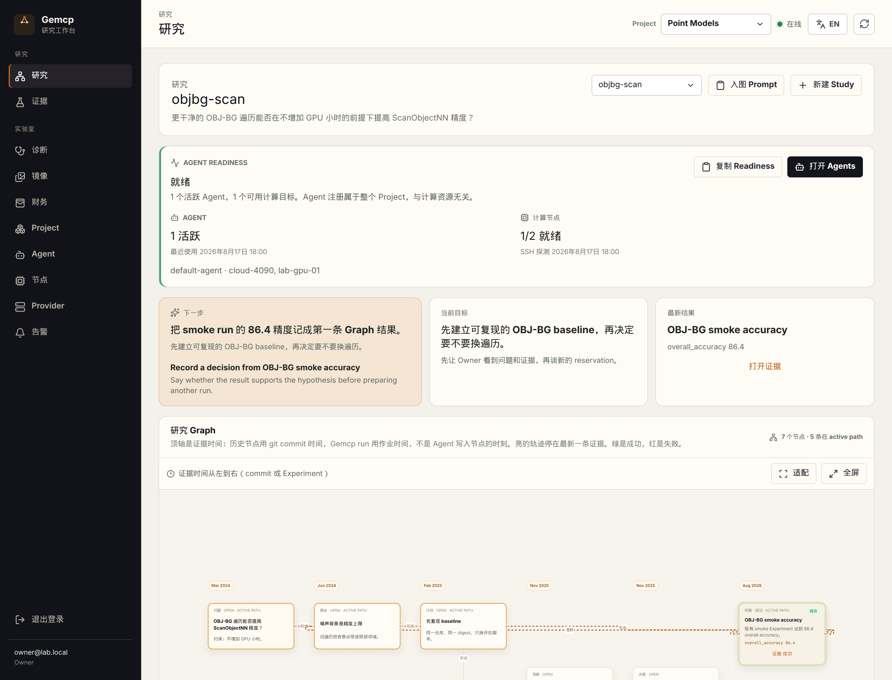

<div align="center">

# Gemcp

**让编码 Agent 帮你跑实验。预算、密钥和一本诚实的实验记录，始终在你手里。**

私有研究工作台。编码 Agent 通过 MCP 提出下一步实验，你确认精确的花费，Gemcp 负责把它调度到笔记本 CPU、SSH 主机、你自己的 GPU 或 AutoDL 上，再把结果写回成证据。

[](https://github.com/XR-Lee/Gemcp/actions/workflows/ci.yml)
[](docs/releases.md)
[](#路线图)
[](go.mod)
[](LICENSE)
[](docs/mcp.md)
[](#benchmark-实测数据)
[](#参与贡献)

[English](README.md) · **中文**

[快速开始](#五分钟本地跑起来笔记本不用-gpu) · [Benchmark](#benchmark-实测数据) · [一次运行怎么走](#一次付费运行怎么走) · [文档](#文档怎么找) · [FAQ](#常见问题) · [参与贡献](#参与贡献)

</div>

> **开发中（WIP）。** Gemcp 还是早期 alpha，API、界面和文档都可能变。现在的反馈会直接影响它最后的样子，欢迎[来聊聊](#参与贡献)。

> **这份 README 给人读。**
> 在本仓库里改代码的 Agent：看 [AGENTS.md](AGENTS.md)。
> 已经通过 MCP 连上运行中 Gemcp 的 Agent：看 [guides/agent-mcp.md](guides/agent-mcp.md)（或调用 `get_usage_guide`）。

<p align="center">
  
</p>
<p align="center"><em>首页是研究视图。预算、Provider、节点、告警都在 Lab，点一下就能到。</em></p>

## 为什么需要 Gemcp？

编码 Agent 很擅长提出下一步实验。可一旦真让它去启动实验，就会遇到三个问题：

| | 问题 | Gemcp 怎么做 |
| --- | --- | --- |
| 💸 **花钱** | 手里有云 Token 的 Agent，可以启动一个你从没批准过的 GPU 任务。 | Agent 只能准备零成本提案，并且在提交前必须把 digest（仓库、commit、命令、资源、最坏情况花费）亮给你看。（[服务端强制校验还没做完](#benchmark-还发现了什么)。） |
| 🧾 **证据** | Agent 的总结和实际跑出来的结果对不上。 | `close_run` 直接从 Experiment 拷贝指标。run 和 result 由系统写入，Agent 事后改不了。 |
| 🔐 **密钥** | Provider Token、SSH 私钥跑进 Agent 的上下文。 | 它们留在单独的 **Lab** 层，带审计。Agent 拿不到。 |

## 你能用来做什么

- 🔬 **先看科学问题** — 控制台从 Study 和 Graph 开始，而不是从 GPU 库存开始。
- ✅ **人确认后再花钱** — Agent 负责准备，你确认精确 digest 之后才会预留预算。
- 🔌 **在研究仓库里开 MCP** — 支持 Cursor、Claude Code、Codex、OpenCode、Grok、Pi。在那个目录启用 Gemcp，不要开成全局 MCP。
- 🖥️ **四条算力路径** — 本地 CPU（不需要 NVIDIA）、Cloud SSH、自建 Docker GPU、或 AutoDL。它们不会悄悄互相 fallback。
- 🧭 **一套用词** — Study、hypothesis、run、result。控制台、MCP 和 [Graph 契约](docs/graph-contract.md) 用同一套词。
- 📏 **给"记录本身"做 benchmark** — CI 会检查 Graph 写的是不是真实发生的事。见 [Benchmark](#benchmark-实测数据)。

## 五分钟本地跑起来（笔记本，不用 GPU）

需要：Go 1.21+（`go.mod` 钉的是 1.26.10，会自动拉官方工具链）、Node.js 22+、本机 `127.0.0.1:5432` 上的 PostgreSQL 16+。Debian/Ubuntu 源里的 Go 和 PostgreSQL 够用来引导。

```bash
./scripts/bootstrap-local.sh
./scripts/dev-serve.sh
```

打开 [http://127.0.0.1:8080](http://127.0.0.1:8080)。第一次访问是初始化（Owner → Compute → Project）。AutoDL 选跳过。把一次性 Agent Token 复制下来，之后不会再显示。Owner 邮箱/密码在 `.env` 的 `GEMCP_DEV_OWNER_*`。

脚本会从 `deploy/env.local.example` 写出仓库根目录的 `.env`，生成 `GEMCP_MASTER_KEY` 和 `GEMCP_BOOTSTRAP_TOKEN`，创建 `gemcp` 角色和数据库，并编译 `./bin/gemcp`。这条路径 **不要** 去抄 `.env.example`（那是生产 Compose 模板）。

第二个终端可以跑自检：

```bash
./scripts/local-http-smoke.sh   # 健康检查、初始化、MCP initialize
./scripts/local-cpu-loop.sh     # 五步 CPU 实验，不需要 NVIDIA
```

顶栏可以切换中文 / English。哪一步卡住了，就是这份文档的 bug —— 欢迎[开个 issue](https://github.com/XR-Lee/Gemcp/issues/new?title=%5Bquick%20start%5D%20)。

## Benchmark 实测数据

怎么知道 Graph 说的是实话？我们去量它。

[`internal/researchbench`](docs/research-bench.md)（英文）用真实的 MCP 服务端（SQLite）跑四个答案已知的小研究任务。每个任务藏一个陷阱：一个碰巧好看的随机种子、一条误导性的外部说法、粗网格扫不到的最优点、或者会爆显存的 batch size。三个脚本化 Agent 去做这些任务，评分器再通过 MCP 把记录读回来，不相信 Agent 自己的说法。每个 pull request 的 CI（`go test ./...`）都会跑它，任何一项记录指标退化就会失败。

**Owner 看到的记录：证据修复前后对比**（同样的 Agent、同样 4 个任务、49 次运行）：

| 记录指标 | 修复前¹ | 现在的 `main`² |
| --- | ---: | ---: |
| 每次运行的结论记录正确 | 15/49（31%） | **49/49（100%）** |
| Graph 上错误的 `supports` | 29 | **0** |
| 崩溃的运行被当成证据 | 5/5 | **0/5** |
| 同一运行既 supports 又 contradicts | 12 | **0** |
| 数字标明是"实测"还是"引述" | 0/100 | **100/100** |
| Plan-sync 报告检查通过 | 24/134（18%） | **134/134（100%）** |
| 崩溃后给出误导性的下一步 | 5/5 | **0/5** |
| 事后篡改证据并且改成功 | 4/5 | **0/5** |
| 每次运行的工具调用数 | 7.7 | **5.6**（−27%） |
| 每次运行的工具输出量 | 57.1 KB | **35.9 KB**（−37%） |

<sub>¹ `main` 的 `79cdb72`，即修复 `df0a3bb`、`6bd24cf` 之前。² `b546e47`。两列都是为这一页用同一套 harness 重新跑出来的。完整表格（包括每一种篡改尝试）：[docs/research-bench.md](docs/research-bench.md#results)（英文）。</sub>

**这个 benchmark 能区分好研究和坏研究。** 脚本化 Agent 是参考策略，不是语言模型：

| Agent | 策略 | 结论正确 | 搜索任务解出 | 平均归一化得分 S |
| --- | --- | ---: | ---: | ---: |
| `careful` | 先粗网格，再在最优点附近细化；效应类问题跑三个种子 | 4/4 | 2/2 | 1.00 |
| `grid` | 整个预算均匀撒网格 | 4/4 | 1/2 | 0.74 |
| `hasty` | 只跑一次、一个种子；把崩溃当成负面结果 | 1/4 | 0/2 | −0.01 |

大约五秒就能复现，不需要 GPU，也不需要 PostgreSQL：

```bash
go test ./internal/researchbench -run TestResearchBench -v
```

### Benchmark 还发现了什么

下面这些还没解决，每一条都适合拿来开个讨论或者提个 PR：

- **Owner 确认目前是约定，还没有服务端强制。** `prepare_experiment` 把 digest 返回给 Agent，`submit_prepared_experiment` 不经 Owner 也会接受。指南要求 Agent 等你确认，但无人值守的 bot 可以跳过。
- **工具输出随 Graph 变大。** 每次写 Graph 都会返回整个工作区 —— 12 次运行的 Study 里大约每次运行 39 KB，对语言模型 Agent 是实打实的上下文开销。
- **一条 hypothesis 大约只能挂 42 次运行。** Study 上限 128 个节点，每次运行的 run、result、highlight 都算在内，而且拒绝发生在提交时。
- **执行是模拟的。** 调度器、Provider、Runner 和产物由 [诊断](docs/diagnostics.md) 和 `./scripts/local-cpu-loop.sh` 覆盖，不在这个 benchmark 里。

### 🏁 来测测你的 Agent

评分器只读 MCP，所以能给 *任何* Agent 在真实 Gemcp 上跑出来的 Study 打分：Claude Code、Cursor、Codex、OpenCode、Grok、Pi，或者你自己写的。目前我们还没有真实语言模型的成绩。跑一个任务，然后[在 issue 里贴出你的数字](https://github.com/XR-Lee/Gemcp/issues/new?title=%5Bbench%5D%20%3Cagent%3E%20on%20%3Ctask%3E) —— 失败的结果和成功的一样有用。步骤见 [Grading a live agent](docs/research-bench.md#grading-a-live-agent)（英文）。

## 一次付费运行怎么走

```text
你在 Graph 上记下一条 hypothesis
        │
Agent 零成本准备提案          (prepare_experiment)
        │
你确认精确 digest
        │
Agent 提交一次                (submit_prepared_experiment)
        │
Gemcp 写入 run，再用 close_run 写回 result
```

在 Graph 上记一个节点 **不会** 启动机器。`submit_experiment` 是旧的 Advanced 兼容路径，有活跃 Study 时会被拒绝。

<p align="center">
  
</p>
<p align="center"><em>Graph 是科学谱系，不是 git commit 图。付费运行必须从一条连得上的 hypothesis 出发。</em></p>

## 接上一个 Agent

1. 登录后打开 **Lab → Agent**。
2. 创建一次性 **MCP setup link**（如果还要 Cloud SSH，用 Handshake prompt）。只发给目标 Agent，并且让它在研究仓库目录里启用。
3. 让 Agent 自己完成注册。不要把长期 Token 贴进聊天。
4. 任何付费运行之前，Agent 必须把提案亮给你看（仓库、commit、命令、资源、最坏情况人民币、confirmation digest）。你确认这个精确 digest —— 在 Evidence 里确认，或明确授权 Agent 提交它。

有 Token 之后，Cursor 项目配置（`.cursor/mcp.json`）：

```json
{
  "mcpServers": {
    "gemcp-project": {
      "type": "http",
      "url": "http://127.0.0.1:8080/mcp",
      "headers": {
        "Authorization": "Bearer ${env:GEMCP_AGENT_TOKEN}"
      }
    }
  }
}
```

生产环境用 `https://<gemcp-host>/mcp`。各客户端完整片段：[Owner MCP 指南](guides/owner-mcp.md)。工具列表：[MCP 客户端](docs/mcp.md)。

`submit` 权限只是技术能力，不是空白支票。每条准备好的提案，仍然要你确认那条 digest。

## 活跑在哪

| 后端 | 典型用途 | GPU |
| --- | --- | --- |
| 本地进程 | 笔记本冒烟 / CPU 夹具 | 不需要 |
| Cloud SSH（实验性） | 在已登记的 Linux 机器上直接跑 argv | 可选 |
| 自建节点 | 你自己的机器上 `gemcp-node` + Docker | NVIDIA |
| AutoDL 私有云 / 公有弹性 | 官方 Job API | 需要 |

付费 AutoDL 需要能从外网访问的 HTTPS `GEMCP_PUBLIC_URL`，并且打开调度器。Cloud SSH 要到 `GEMCP_SSH_CLOUD_ENABLED=true` 才会启用。细节：[自建节点](docs/self-hosted-nodes.md)、[Cloud SSH](docs/ssh-cloud-nodes.md)、[Provider](docs/provider-operations.md)。

```text
你  --HTTPS Web-->  Gemcp  --MCP-->  编码 Agent
                      |
                      +--> PostgreSQL
                      +--> 本地 CPU / SSH 主机 / gemcp-node / AutoDL
```

Vue 控制台嵌在 Go 发布二进制里。不需要 Redis、Kubernetes，也不需要单独跑前端。

## 路线图

已发布和计划中的工作索引在 [docs/roadmap.md](docs/roadmap.md)，每个版本的说明在 [docs/releases.md](docs/releases.md)。

**已发布：** 通过 HTTPS 或 SSH 登记 GitHub 仓库。公开仓库用匿名 HTTPS 激活；私有仓库继续用只读 Deploy Key，Deploy Key 被禁用时可以用只写的 HTTPS token。Owner 不需要 Agent Token 也能在 Evidence 里准备提案：一个审过的 `gemcp.yaml` workload，或者从一次成功运行另存的 Project workload。

**已在 `main`：** `close_run` 接受显式 `verdict`；跑完不再自动等于证据；系统写入的证据不能再被改写。效果见 [Benchmark](#benchmark-实测数据)。

**之后：** 常设审批、数据集快照、构建会话。还需要目标机器或新授权付费资源才能验证的项目，在 [Further validation](docs/roadmap.md#further-validation)。[Benchmark 还发现了什么](#benchmark-还发现了什么) 里的几条也是候选 —— 告诉我们哪条对你最重要。

## 文档怎么找

| 你想… | 看这里 |
| --- | --- |
| 当人来用产品（本页） | [README.md](README.md) · [README.zh.md](README.zh.md) |
| 给 Cursor / Claude / Codex 接线 | [guides/owner-mcp.md](guides/owner-mcp.md) |
| **作为** MCP Agent 操作 Gemcp | [guides/agent-mcp.md](guides/agent-mcp.md) |
| 在本仓库里改代码 | [AGENTS.md](AGENTS.md) |
| 搞清 Study / hypothesis / run / result | [docs/graph-contract.md](docs/graph-contract.md) |
| 走一遍控制台 | [docs/web-console.md](docs/web-console.md) · [docs/research-workbench.md](docs/research-workbench.md) |
| 看角色关系图 | [docs/framework-map.html](docs/framework-map.html)（中文） |
| 测一个 checkout | [docs/tester-brief.zh.md](docs/tester-brief.zh.md) |
| 衡量 Agent 通过 Gemcp 做研究的质量 | [docs/research-bench.md](docs/research-bench.md)（英文） |
| Compose 部署 | [deploy/README.md](deploy/README.md) |
| 看发了什么 | [docs/releases.md](docs/releases.md) · [docs/roadmap.md](docs/roadmap.md) |
| 提想法或 pull request | [参与贡献](#参与贡献) · [Issues](https://github.com/XR-Lee/Gemcp/issues) |

运行中的控制平面也会在 `/docs/owner-mcp.md` 和 `/docs/agent-mcp.md` 提供 Owner / Agent 指南。再往下：[setup API](docs/setup-api.md)、[Agent Token](docs/agent-tokens.md)、[架构](docs/architecture.md)、[执行](docs/execution.md)、[财务](docs/finance.md)、[诊断](docs/diagnostics.md)、[通知](docs/notifications.md)。

## 生产部署

```bash
./bin/gemcp keygen
./bin/gemcp bootstrap-token
cp .env.example deploy/.env
# 填入刚生成的凭据，保持 GEMCP_ENV=production
cd deploy
docker compose up -d --build
```

把源站绑在 localhost，用已配置的 Cloudflare Tunnel 对外。不要把 8080 暴露到公网。已有 Compose 部署在重建数据库容器前，必须先做 [PostgreSQL 18 卷升级](deploy/README.md#postgresql-18-volume-upgrade)。

完整清单：[deploy/README.md](deploy/README.md)。

## 开发

```bash
npm --prefix frontend install
make test
make frontend-test
make build
```

浏览器测试（每台机器做一次）：

```bash
npx --prefix frontend playwright install chromium
make frontend-e2e
```

## 安全

仓库里不要放真实的 AutoDL、SMTP、Git、Runner、Agent setup、Node setup 或实验密钥。Provider、SMTP 和 Git 私钥静态加密。Agent / Node 的 setup code 和长期 Token 只存 HMAC 摘要。AutoDL Runner Token 按 Attempt 作用域发放，不会进用户命令环境。自建作业容器拿不到任何 Gemcp 凭据。

## 不做什么

- 在 Graph 上记一个节点不会启动机器。付费运行仍然需要 [一次付费运行怎么走](#一次付费运行怎么走) 里确认过的 digest。
- Provider Token、节点凭据和 SSH 材料留在 Lab，Agent 拿不到。
- AutoDL、自建节点和 Cloud SSH 不会悄悄互相 fallback。
- 不需要 Redis 和 Kubernetes。Vue 控制台嵌在 Go 二进制里。

这些是有意为之，但不是不能讨论。如果哪一条挡住了你，[开个 issue](https://github.com/XR-Lee/Gemcp/issues) 说说理由。

## 常见问题

**需要 GPU 吗？** 不需要。[快速开始](#五分钟本地跑起来笔记本不用-gpu)、`./scripts/local-cpu-loop.sh` 和 benchmark 都能在笔记本 CPU 上跑。

**支持哪些 Agent？** 任何支持 Streamable HTTP 的 MCP 客户端。[Owner MCP 指南](guides/owner-mcp.md) 里有 Cursor、Claude Code、Codex、OpenCode、Grok、Pi 的配置。

**Gemcp 会往我的仓库 push 吗？** 不会。Plan sync 只是对研究计划文档做一次 dry-run 修订；Gemcp 从不 push git。

**有托管版吗？** 没有。Gemcp 是自托管的：在笔记本上跑，或者用 [Compose](deploy/README.md) 部署在你自己的 tunnel 后面。

**这是 Ruby 的 `gemcp` gem 吗？** 不是。本项目和 `baweaver/gemcp` 无关。

## 参与贡献

非常欢迎想法、反馈、issue 和 pull request。Gemcp 还很早期，真正在跑实验的人给的反馈是最有价值的。

**不写代码也能帮忙：**

- 🧪 **跑一遍[快速开始](#五分钟本地跑起来笔记本不用-gpu)**，告诉我们哪里卡住了。五行字的"踩坑" issue 就是实打实的贡献。
- 🏁 **[测一测你在用的 Agent](#-来测测你的-agent)**，把数字贴出来。
- 🧩 **加一个 benchmark 任务**，里面放一个粗心 Agent 会踩的陷阱（[怎么加](docs/research-bench.md#adding-a-task)，英文）。
- 🔌 **试试别的 MCP 客户端或算力后端**，告诉我们哪里坏了。
- 💬 **质疑一个设计选择。** [不做什么](#不做什么) 和 [还没解决的问题](#benchmark-还发现了什么) 都是不错的起点。

**提想法。** 开一个 [issue](https://github.com/XR-Lee/Gemcp/issues)。bug、问题、建议、benchmark 结果都可以：说清楚你想要什么、为什么。本仓库没有开 Discussions，所以 Issues 就是讨论的地方。标题加个前缀，比如 `[idea]`、`[question]`、`[bench]`，会更好找。中文、英文都可以。

**发 pull request。** 从 `main` 拉分支，对 `main` 提 pull request。改动保持聚焦，写清楚改了什么、怎么验证的。常用命令见 [开发](#开发)。改到 `close_run`、Graph、plan sync 或研究相关 MCP 工具时，要保持 `go test ./internal/researchbench` 通过。在本仓库里干活的编码 Agent 先读 [AGENTS.md](AGENTS.md)。

issue 和 diff 里都不要放真实凭据。见 [安全](#安全)。提交的贡献按 [MIT 许可证](LICENSE) 授权。

## 许可证

[MIT](LICENSE)。如果 Gemcp 对你有用，点个 ⭐ 能帮更多研究者找到它。
